<div align="center">


# Raspberry Pi 4 Hadoop and Spark Cluster

**Build a 3-node big data cluster at home. Store data with HDFS. Process data with Spark on YARN.**

<a href="https://github.com/aimanamri/raspberry-pi4-hadoop-spark-cluster"></a>
<a href="https://github.com/aimanamri/raspberry-pi4-hadoop-spark-cluster"></a>
<a href="https://github.com/aimanamri/raspberry-pi4-hadoop-spark-cluster/stargazers"></a>
<a href="https://github.com/aimanamri/raspberry-pi4-hadoop-spark-cluster/commits/main"></a>
<a href="https://github.com/aimanamri/raspberry-pi4-hadoop-spark-cluster"></a>

Author: [Aiman Amri](https://www.linkedin.com/in/aiman-amri/) · Last updated: 15/11/2026 16:00 GMT+8 · [Config files](https://github.com/aimanamri/raspberry-pi4-hadoop-spark-cluster/tree/main/config_files)

</div>

---

## Contents

1. [Overview](#overview)
2. [What you need](#what-you-need)
3. [Cluster plan](#cluster-plan)
4. [Automated setup with scripts (optional)](#automated-setup-with-scripts-optional)
5. [Part 1: Prepare the Raspberry Pis](#part-1-prepare-the-raspberry-pis)
6. [Part 2: Install Java 17](#part-2-install-java-17)
7. [Part 3: Install and configure Hadoop 3.5.0](#part-3-install-and-configure-hadoop-350)
8. [Part 4: Start HDFS and YARN](#part-4-start-hdfs-and-yarn)
9. [Part 5: Install and configure Spark 4.3.0](#part-5-install-and-configure-spark-430)
10. [Part 6: Run Spark jobs](#part-6-run-spark-jobs)
11. [Part 7: Verify the cluster](#part-7-verify-the-cluster)
12. [Quick reference](#quick-reference)
13. [Sources and more information](#sources-and-more-information)

---

## Overview

This project is my own record of learning distributed data storage, parallel processing and Linux. It uses Apache Hadoop, Apache Spark and Raspberry Pi OS.

You build a cluster of three Raspberry Pi 4 computers. You install HDFS on the cluster. You run Spark jobs through YARN. You can add more nodes later to make the cluster larger.

This guide does not use MapReduce, the Hadoop processing engine. It uses Spark, because Spark is faster and easier to use.

> [!TIP]
> **You can automate these steps.** The [`scripts/`](./scripts) folder has Bash scripts that do Parts 1 to 7 for you. They detect Raspberry Pi OS or Ubuntu, and they read names, IP addresses and versions from one settings file. This guide shows every step by hand, so that you know what the scripts do. See [Automated setup with scripts](#automated-setup-with-scripts-optional).

<p align="center">
  
</p>

| Component | Role in the cluster |
| --- | --- |
| **HDFS** (Hadoop Distributed File System) | Stores data across all nodes. |
| **YARN** | Gives CPU and memory to Hadoop jobs and Spark jobs. |
| **Spark** | Processes large data sets in parallel. It keeps data in memory. It has APIs for Java, Scala, Python and R. |
| **Spark on YARN** | Runs Spark jobs on the cluster. You start a job in cluster mode or client mode. You do not use standalone mode. |

## What you need

| Item | Details |
| --- | --- |
| **Raspberry Pi 4** | 3 units. See the [data sheet](https://docs.rs-online.com/b1fb/0900766b816fa153.pdf). Each Pi needs its own power supply (minimum 5 V / 3 A DC or 5.1 V / 3 A DC). |
| **Micro SD card** | 1 card for each Pi. You also need a micro SD card reader. |
| **Ethernet cables** | Optional. Use them if you want a wired network. |
| **Hadoop** | Version 3.5.0 |
| **Spark** | Version 4.3.0 |
| **Java** | Java 17 on each Pi. Hadoop 3.5.0 needs Java 17 for the daemons. Spark 4.3.0 supports Java 17, 21 and 25. |
| **Python** | Python 3.11 or later, for PySpark. Run `python3 --version` to check. Ubuntu 22.04 has Python 3.10, which is too old. Use Ubuntu 24.04, Raspberry Pi OS Bookworm or Trixie, or do not use PySpark. |
| **64-bit OS** | Raspberry Pi OS 64-bit or Ubuntu Server 64-bit (arm64) on each Pi. |

## Cluster plan

This guide uses the names, addresses and ports in the tables below. If you use other values, change them in each step.

| Host name | Role | IP address | Daemons |
| --- | --- | --- | --- |
| `pi1` | Master | `192.168.35.11` | NameNode, SecondaryNameNode, ResourceManager |
| `pi2` | Worker | `192.168.35.12` | DataNode, NodeManager |
| `pi3` | Worker | `192.168.35.13` | DataNode, NodeManager |

| Service | Address |
| --- | --- |
| HDFS NameNode | `hdfs://pi1:9000` |
| HDFS web UI | http://pi1:9870 |
| YARN web UI | http://pi1:8088 |
| Spark History Server | http://pi1:18080 |

---

## Automated setup with scripts (optional)

You do not have to use the scripts. The steps in Parts 1 to 7 work without them. The scripts do the same steps and use the same files as this guide.

**What the scripts do**
- They detect the OS (Raspberry Pi OS, Ubuntu or Debian) and use the right commands for it.
- They get all names, IP addresses, versions and memory sizes from one settings file, `scripts/.env`.
- They check the SHA-512 checksum of each download.
- You can run them again. They do not repeat finished work.

**How to use them**

1. Copy the settings file and change the values for your cluster.
```bash
cp scripts/.env.example scripts/.env
nano scripts/.env
```
2. On **each** Pi, run the node setup script. It does Part 1.4 to 1.7 and Part 2.
```bash
sudo ./scripts/setup-node.sh
```
3. On the **master** Pi, log in as the `hadoop` user, get this repository and run the master scripts. They do Part 1.8, Parts 3 to 5 and Part 7.
```bash
./scripts/install-all.sh
```

| Script | Guide part |
| --- | --- |
| `setup-node.sh` (each Pi) | 1.4 to 1.7, Part 2 |
| `setup-ssh.sh` (master) | 1.8 |
| `install-hadoop.sh` (master) | Part 3 |
| `start-cluster.sh` (master) | Part 4 |
| `install-spark.sh` (master) | Part 5 |
| `verify.sh` (master) | Part 7 |

> [!NOTE]
> The scripts do not set static IP addresses, write the SD cards or set up Wi-Fi. Do Parts 1.1 to 1.3 and 1.5 by hand. For all options and settings, see [`scripts/README.md`](./scripts/README.md).

---

## Part 1: Prepare the Raspberry Pis

### 1.1 Build the hardware
Put all Pis in a rack made for Pis. Connect the power supplies to turn the Pis on.

<p float="right">
  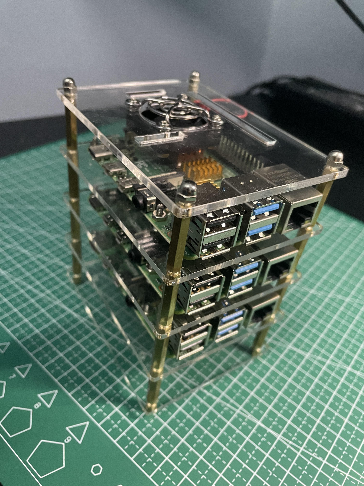 
  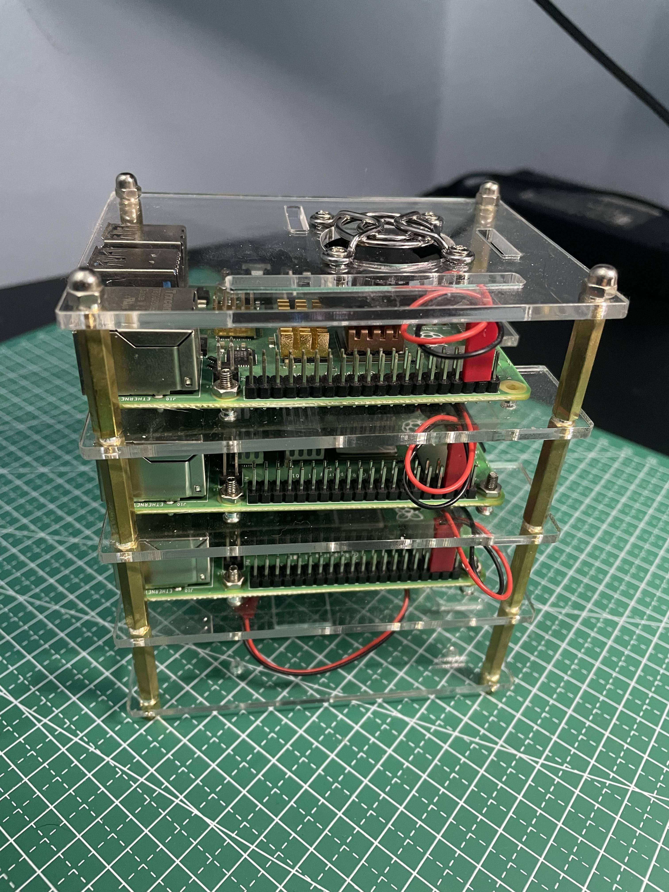 
  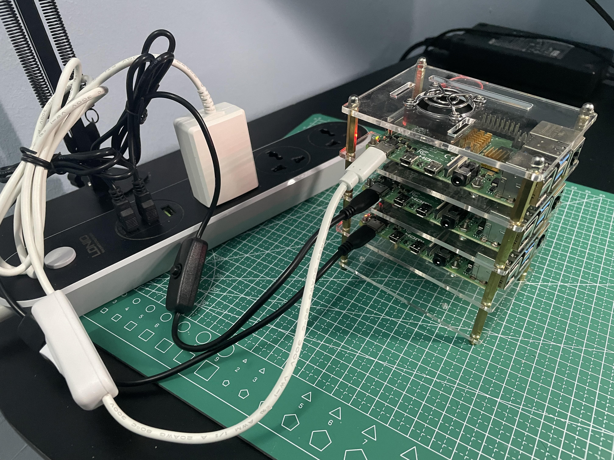 
</p>

### 1.2 Install the operating system
Use **Raspberry Pi OS with desktop** (it has a GUI) on the master Pi. Use **Raspberry Pi OS Lite** (it has only a CLI) on the worker Pis. Use the [Raspberry Pi Imager](https://www.raspberrypi.com/software/) to write **Raspberry Pi OS 64 Bit** to each SD card.

<p float="right">
  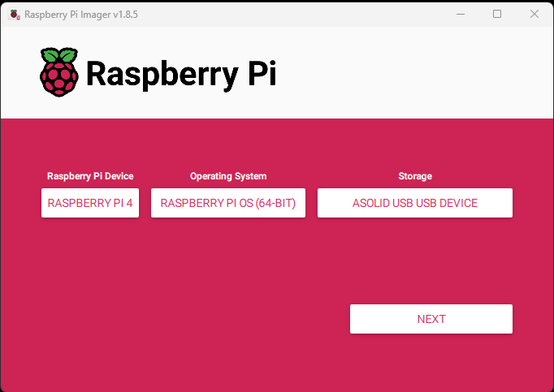
  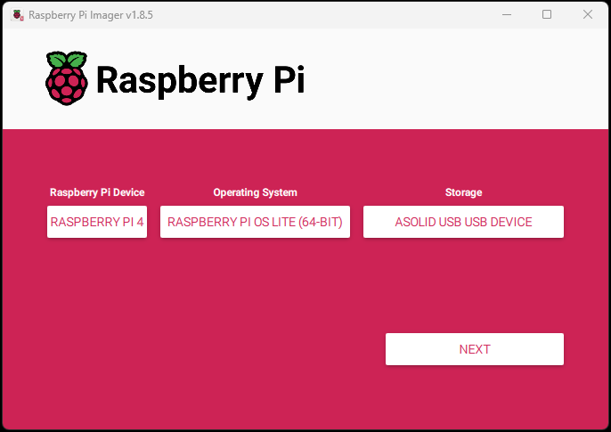 
</p>

### 1.3 Set the host name, SSH and network
In the Imager, set the host name and the SSH login on each Pi. This guide uses Wi-Fi. If you use a wired network, do not set up Wi-Fi.

> [!TIP]
> A wired network is more stable. Use it if you can, especially when you copy large files between the Pis.

  
<p float="right">
  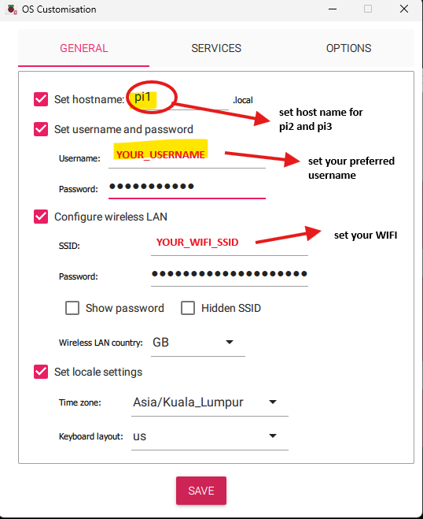 
  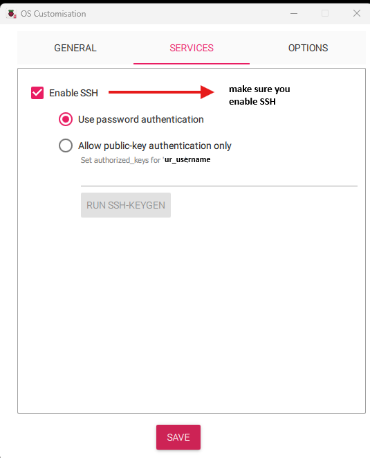 
</p>

### 1.4 Update the system

> [!TIP]
> **Script:** `sudo ./scripts/setup-node.sh` does steps 1.4, 1.6 and 1.7 and installs Java (Part 2).

> [!IMPORTANT]
> Do these steps on **each** Pi.

Update the packages, expand the file system and restart the Pi.
```bash
sudo apt update
sudo apt upgrade -y
sudo raspi-config --expand-rootfs
sudo reboot now
```

### 1.5 Set a static IP address
Each Pi needs a static IP address. In this project, I set the addresses on my home router. I use `192.168.35.XX`. A home network is usually `192.168.0.XX`.

You can also set the addresses in the `/etc/network/interfaces` file.

### 1.6 Set the host names

> [!IMPORTANT]
> Do these steps on **each** Pi.

I set the host name when I wrote the OS to the SD card. You can also edit the `/etc/hostname` file and restart the Pi.

The Pis must find each other by name. Edit the `/etc/hosts` file and add the IP address of each of the three Pis. Delete the `127.0.0.1` localhost line from the file.

File: `/etc/hosts`
```
192.168.35.11    pi1
192.168.35.12    pi2
192.168.35.13    pi3
```

### 1.7 Create the `hadoop` user

> [!IMPORTANT]
> Do these steps on **each** Pi.

Create the user and log in as that user.
```bash
sudo adduser hadoop
sudo usermod -aG sudo hadoop
su - hadoop
```

> [!WARNING]
> From this point, log in as the `hadoop` user for all commands.

### 1.8 Set up password-less SSH

> [!TIP]
> **Script:** `./scripts/setup-ssh.sh` does this step. Run it on the master Pi.

The master node `pi1` uses SSH to connect to the other nodes (`pi2` and `pi3`). The connection uses a key pair. This lets the master node manage the cluster.

> [!IMPORTANT]
> Do these steps on the master Pi, until the text says to do otherwise.

**Step 0.** Create the SSH directory `~/.ssh` if it does not exist. Set the permissions.
```bash
mkdir ~/.ssh
touch ~/.ssh/config
sudo chmod 700 ~/.ssh/
sudo chmod 600 ~/.ssh/*
```

**Step 1.** Create an SSH key pair.
```bash
ssh-keygen -t rsa -b 4096
```
Leave the password field empty. The `hadoop` user must connect without a prompt.

**Step 2.** Do Step 1 again on `pi2` and `pi3`. Log in as the `hadoop` user.

**Step 3.** Create SSH aliases. On every Pi, log in as the `hadoop` user and open the SSH config file.
```bash
nano ~/.ssh/config
```

File: `/home/hadoop/.ssh/config`
```
Host pi1
User hadoop
Hostname 192.168.35.11 

Host pi2
User hadoop
Hostname 192.168.35.12

Host pi3
User hadoop
Hostname 192.168.35.13
```

**Step 4.** Copy the public key of each Pi to `pi1`. Do this on all Pis, including `pi1`.
```bash
ssh-copy-id pi1
```

**Step 5.** Copy the SSH files of `pi1` to the other Pis. In the command, `piX` is `pi2` or `pi3`.
```bash
scp ~/.ssh/authorized_keys piX:~/.ssh/authorized_keys
```

**Check:** Use SSH to connect from the master to each Pi. No password prompt must show.

---

## Part 2: Install Java 17

> [!TIP]
> **Script:** `sudo ./scripts/setup-node.sh` does this part. It uses apt when the OS has Java 17 and SDKMAN when it does not.

Hadoop 3.5.0 needs **Java 17** for the daemons. Spark 4.3.0 supports Java 17, 21 and 25. Use Java 17 on all Pis, so that both programs use the same Java.

> [!IMPORTANT]
> Do these steps on **each** Pi.

**Before you start:** make sure that the OS is 64-bit. The command must show `aarch64`.
```bash
uname -m
```

Choose the method for your OS.

| OS | Method |
| --- | --- |
| Raspberry Pi OS 64-bit **Bookworm** (Debian 12) | Method A: apt |
| Ubuntu Server 64-bit **22.04 or 24.04** | Method A: apt |
| Raspberry Pi OS 64-bit **Trixie** (Debian 13) | Method B: SDKMAN. The Trixie repository has Java 21 and 25, but not Java 17. |
| Any other 64-bit OS | Method B: SDKMAN |

> [!NOTE]
> To find your Debian version, run `cat /etc/os-release`.

### Method A: apt

1. Install Java 17.
```bash
sudo apt update
sudo apt install -y openjdk-17-jdk
```
2. Show the Java version. The first line must show version 17.
```bash
java -version
```
3. Find the Java 17 installation path. On arm64, it is `/usr/lib/jvm/java-17-openjdk-arm64`.
```bash
readlink -f $(which java)
```
4. If another Java version is the default, select Java 17.
```bash
sudo update-alternatives --config java
```

In this guide, `JAVA_HOME` is `/usr/lib/jvm/java-17-openjdk-arm64`.

### Method B: SDKMAN

[SDKMAN](https://sdkman.io) installs Java for one user. Log in as the `hadoop` user on each Pi.

1. Install the tools that SDKMAN needs.
```bash
sudo apt install -y curl zip unzip
```
2. Install SDKMAN and load it.
```bash
curl -s "https://get.sdkman.io" | bash
source ~/.sdkman/bin/sdkman-init.sh
```
3. Show the Java versions that you can install. Find a Temurin (`-tem`) build of Java 17.
```bash
sdk list java
```
4. Install the version. Replace `<identifier>` with the identifier from the list, for example `17.0.xx-tem`. Use the **same identifier on every Pi**. Answer `Y` when SDKMAN asks if it must set the version as the default.
```bash
sdk install java <identifier>
```
5. Show the Java version. The first line must show version 17.
```bash
java -version
```

In this guide, `JAVA_HOME` is then `/home/hadoop/.sdkman/candidates/java/current`. **Use this path in place of `/usr/lib/jvm/java-17-openjdk-arm64` in all later steps.**

> [!IMPORTANT]
> Hadoop starts the daemons on the worker nodes through SSH. These SSH sessions do not load the SDKMAN setup from `.bashrc`. For this reason, you set `JAVA_HOME` in `hadoop-env.sh` in a later step. Do not skip that step.

Java 17 is installed.

---

## Part 3: Install and configure Hadoop 3.5.0

> [!TIP]
> **Script:** `./scripts/install-hadoop.sh` does this part. It writes the configuration files from the values in `scripts/.env`.

### 3.1 Download Hadoop (master node `pi1` only)

> [!IMPORTANT]
> Do these steps on the master Pi, until the text says to do otherwise.

1. Download the Apache Hadoop 3.5.0 binary (aarch64) from the [Apache Hadoop website](https://hadoop.apache.org/releases.html) with `wget`.
```bash
wget https://dlcdn.apache.org/hadoop/common/hadoop-3.5.0/hadoop-3.5.0-aarch64.tar.gz
```
   > [!NOTE]
   > The download URL is different for other versions.

2. Extract the file in the home directory of the `hadoop` user. Then delete the compressed file.
```bash
tar -xzvf hadoop-3.5.0-aarch64.tar.gz
rm hadoop-3.5.0-aarch64.tar.gz
```

### 3.2 Set the environment variables

1. Add the Hadoop binaries to `PATH`. Edit the file and add this line. Then you can run Hadoop commands from any directory.

File: `/home/hadoop/.profile`
```shell
PATH=/home/hadoop/hadoop-3.5.0/bin:/home/hadoop/hadoop-3.5.0/sbin:$PATH
```

2. Add Hadoop to `PATH` for the shell. Edit the `.bashrc` file and add these lines.

File: `/home/hadoop/.bashrc`
```shell
# path and options for java
export JAVA_HOME=/usr/lib/jvm/java-17-openjdk-arm64

# path and options for Hadoop
export HADOOP_HOME=/home/hadoop/hadoop-3.5.0
export PATH=$PATH:$HADOOP_HOME/bin:$HADOOP_HOME/sbin

export HADOOP_INSTALL=$HADOOP_HOME
export HADOOP_MAPRED_HOME=$HADOOP_HOME
export HADOOP_COMMON_HOME=$HADOOP_HOME
export HADOOP_HDFS_HOME=$HADOOP_HOME
export HADOOP_INSTALL=$HADOOP_HOME
export YARN_HOME=$HADOOP_HOME
export HADOOP_COMMON_LIB_NATIVE_DIR=$HADOOP_HOME/lib/native
export HADOOP_CONF_DIR=$HADOOP_HOME/etc/hadoop
export HADOOP_OPTS="-Djava.library.path=$HADOOP_HOME/lib/native"
```
Load the `.bashrc` file again.
```bash
source ~/.bashrc
```

3. Set `JAVA_HOME` in `hadoop-env.sh`. Scroll down to find the correct line. Remove the comment mark (`#`) from the line. Enter the path of your Java installation.

File: `/home/hadoop/hadoop-3.5.0/etc/hadoop/hadoop-env.sh`
```shell
export JAVA_HOME=/usr/lib/jvm/java-17-openjdk-arm64
```

### 3.3 Edit the HDFS configuration files

1. **Set the NameNode location.** Edit the `core-site.xml` file. Set the NameNode to `pi1` on port 9000.

File: `~/hadoop-3.5.0/etc/hadoop/core-site.xml`

```xml
<configuration>
    <property>
        <name>fs.defaultFS</name>
        <value>hdfs://pi1:9000</value>
    </property>
</configuration>
```

2. **Set the HDFS paths.** Edit the `hdfs-site.xml` file to look like this.

File: `~/hadoop-3.5.0/etc/hadoop/hdfs-site.xml`
```xml
<configuration>
    <property>
        <name>dfs.replication</name>
        <value>1</value>
    </property> 
    <property>
		<name>dfs.namenode.name.dir</name>
        <value>/home/hadoop/hdfs/namenode/</value>
    </property> 
    <property>
		<name>dfs.datanode.data.dir</name>
        <value>/home/hadoop/hdfs/datanode/</value>
    </property> 
</configuration>
```
The `dfs.replication` property sets how many copies of each data block the cluster keeps. The default value is `3`. Set `2` to keep each block on two nodes. Do not set a value higher than the number of worker nodes.

3. In the `hadoop` home directory on each node (`pi1`, `pi2` and `pi3`), create the HDFS folders.
```bash
mkdir -p /home/hadoop/hdfs/{namenode,datanode}
```

4. **Set YARN as the framework for MapReduce.** Edit the `mapred-site.xml` file.

File: `~/hadoop-3.5.0/etc/hadoop/mapred-site.xml`
```xml
<configuration>
    <property>
        <name>mapreduce.framework.name</name>
        <value>yarn</value>
    </property>
    <property>
        <name>yarn.app.mapreduce.am.env</name>
        <value>HADOOP_MAPRED_HOME=$HADOOP_HOME</value>
    </property>
    <property>
        <name>mapreduce.map.env</name>
        <value>HADOOP_MAPRED_HOME=$HADOOP_HOME</value>
    </property>
    <property>
        <name>mapreduce.reduce.env</name>
        <value>HADOOP_MAPRED_HOME=$HADOOP_HOME</value>
    </property>
    <property>
        <name>yarn.app.mapreduce.am.resource.mb</name>
        <value>512</value>
    </property>
    <property>
        <name>mapreduce.map.memory.mb</name>
        <value>256</value>
    </property>
    <property>
        <name>mapreduce.reduce.memory.mb</name>
        <value>256</value>
    </property>
</configuration>
```

> [!NOTE]
> For a **single-node** cluster: format the HDFS, run `start-dfs.sh`, and then you can use HDFS.

### 3.4 Configure YARN (multi-node cluster)

1. Edit the `yarn-site.xml` file. It has the YARN configuration options.

   > [!NOTE]
   > The CapacityScheduler is the default scheduler in Hadoop 3.5.0, so you do not set `yarn.resourcemanager.scheduler.class`. You set the queues (**`dev`** and **`prod`**) in the `capacity-scheduler.xml` file in step 2.

File: `~/hadoop-3.5.0/etc/hadoop/yarn-site.xml`
```xml
<configuration>
    <property>
        <name>yarn.nodemanager.aux-services</name>
        <value>mapreduce_shuffle</value>
    </property>
    <property>
        <name>yarn.nodemanager.env-whitelist</name>
        <value>JAVA_HOME,HADOOP_COMMON_HOME,HADOOP_HDFS_HOME,HADOOP_CONF_DIR,CLASSPATH_PREPEND_DISTCACHE,HADOOP_YARN_HOME,HADOOP_HOME,PATH,LANG,TZ,HADOOP_MAPRED_HOME</value>
    </property>
    <property>
        <name>yarn.acl.enable</name>
        <value>0</value>
    </property>
    <property>
        <name>yarn.resourcemanager.hostname</name>
        <value>pi1</value>
    </property>
    <property>
        <name>yarn.nodemanager.resource.memory-mb</name>
        <value>1536</value>
    </property>
    <property>
        <name>yarn.scheduler.maximum-allocation-mb</name>
        <value>1536</value>
    </property>
    <property>
        <name>yarn.scheduler.minimum-allocation-mb</name>
        <value>128</value>
    </property>
    <property>
        <name>yarn.nodemanager.vmem-check-enabled</name>
        <value>false</value>
    </property>
</configuration>
```

> [!NOTE]
> The `capacity-scheduler.xml` file in step 2 gives **`70%`** of the resources to the `prod` queue and **`30%`** to the `dev` queue. A queue can use more than its share when the other queue does not use its resources. YARN can show a tiny rounding difference in the queue values, for example `30.000002`. This is normal.

2. Edit the `capacity-scheduler.xml` file. Copy the content of this [file](https://raw.githubusercontent.com/aimanamri/raspberry-pi4-hadoop-spark-cluster/main/config_files/capacity-scheduler.xml) exactly.

File: `~/hadoop-3.5.0/etc/hadoop/capacity-scheduler.xml`

### 3.5 Set the workers

Edit the `~/hadoop-3.5.0/etc/hadoop/workers` file. The Hadoop helper scripts use this file to start the daemons on the worker nodes.
```
pi2
pi3
```

### 3.6 Copy Hadoop to each node

1. Use SSH to connect to `pi2` and then `pi3`. Run these commands.
```bash
sudo mkdir hadoop-3.5.0
sudo chown -R hadoop:hadoop hadoop-3.5.0/
```

2. On the master node, copy the Hadoop files to the worker nodes.
```bash 
for pi in pi2 pi3; do rsync -avxP ~/hadoop-3.5.0/ $pi:/home/hadoop/hadoop-3.5.0/; done
```

### 3.7 Format HDFS
Format the HDFS the first time you start it. Run this command on the master node `pi1`.

> [!CAUTION]
> This command deletes all data in the HDFS.

```bash
hdfs namenode -format
```

Hadoop is now configured.

---

## Part 4: Start HDFS and YARN

> [!TIP]
> **Script:** `./scripts/start-cluster.sh` starts HDFS, YARN and the Spark History Server. Use `--stop` to stop them.

1. Start HDFS and YARN.
```bash
start-dfs.sh && start-yarn.sh
```

2. Run the `jps` command on each node. Make sure that all processes run.

   On the master node **`pi1`**, the output is as follows. The PID numbers are different on your Pi.
```
5733 Jps
5623 ResourceManager
5435 SecondaryNameNode
5245 NameNode
```
   On **`pi2`** and **`pi3`**, the output is as follows.
```
1538 DataNode
1720 Jps
1640 NodeManager
```

3. To stop HDFS and YARN on all nodes, run this command on `pi1`.
```bash
stop-dfs.sh && stop-yarn.sh
```

### Monitor HDFS and YARN in the web UI

| Service | Address |
| --- | --- |
| HDFS | http://pi1:9870 |
| YARN | http://pi1:8088 |

<p float="right">
  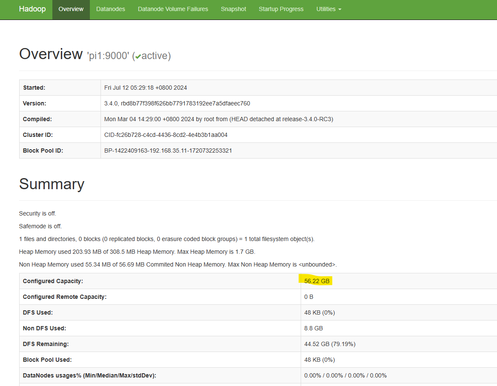 
  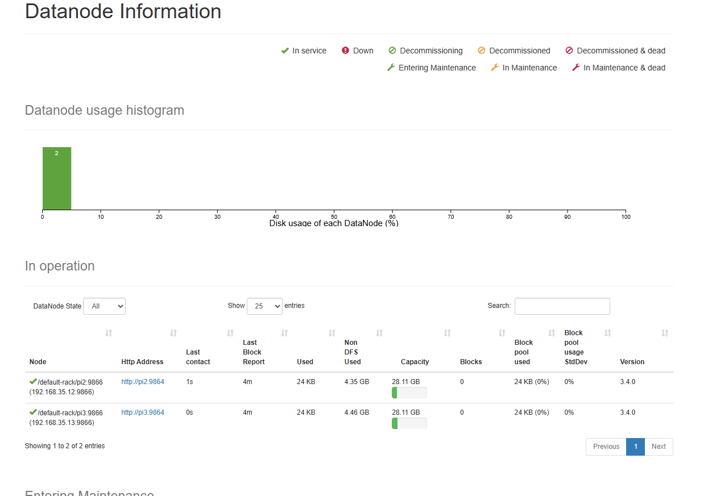 
  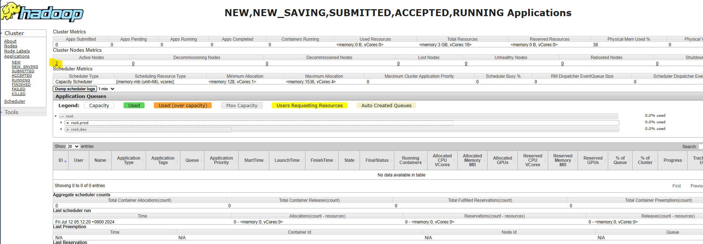 
</p>

The Hadoop cluster now works.

---

## Part 5: Install and configure Spark 4.3.0

> [!TIP]
> **Script:** `./scripts/install-spark.sh` does steps 5.1 to 5.3.

> [!IMPORTANT]
> Do these steps on the master Pi `pi1` only.

### 5.1 Download Spark

1. Download the Apache Spark 4.3.0 binary from the [Apache Spark website](https://spark.apache.org/downloads.html) with `wget`.
```bash
wget https://dlcdn.apache.org/spark/spark-4.3.0/spark-4.3.0-bin-hadoop3.tgz
```
   > [!NOTE]
   > The download URL is different for other versions.

2. Extract the file in the home directory of the `hadoop` user and rename the directory. Then delete the compressed file.
```bash
tar -xzvf spark-4.3.0-bin-hadoop3.tgz
mv spark-4.3.0-bin-hadoop3 spark-4.3.0
rm spark-4.3.0-bin-hadoop3.tgz
```

### 5.2 Set the environment variables

1. Add the Spark binaries to `PATH`. Edit the file and add these lines.

File: `/home/hadoop/.profile`
```shell
# add SPARK bin and sbin to the end of the line PATH variable
PATH=/home/hadoop/spark-4.3.0/bin:/home/hadoop/spark-4.3.0/sbin:$PATH
```

2. Add Spark to `PATH` for the shell. Edit the `.bashrc` file and add these lines.

File: `/home/hadoop/.bashrc`
```shell
# path and options for Spark
export SPARK_HOME=/home/hadoop/spark-4.3.0
export PATH=$PATH:$SPARK_HOME/bin
export LD_LIBRARY_PATH=$HADOOP_HOME/lib/native:$LD_LIBRARY_PATH
export PYSPARK_PYTHON=python3
# add SPARK bin and sbin to the end of the line PATH variable
export PATH=/home/hadoop/spark-4.3.0/bin:/home/hadoop/spark-4.3.0/sbin:$PATH
```
Load the `.bashrc` file again.
```bash
source ~/.bashrc
```

### 5.3 Configure Spark for YARN

1. **Make sure that Spark finds the YARN configuration.** Spark reads `HADOOP_CONF_DIR` to find the cluster. You set it in the `.bashrc` file in Part 3. You do not need the Spark `workers` file. Only the Spark standalone mode uses it.

2. **Set the memory.** The default configuration is not good enough for nodes with less than 4 GB of RAM. The node can swap memory, run slowly, or fail to start an application. [More information](https://www.linode.com/docs/guides/install-configure-run-spark-on-top-of-hadoop-yarn-cluster/)
```bash 
cp spark-defaults.conf.template spark-defaults.conf
```
Edit the `spark-defaults.conf` file and add these lines.

File: `/home/hadoop/spark-4.3.0/conf/spark-defaults.conf`
```
spark.driver.memory 512m
spark.yarn.am.memory 512m
spark.executor.memory 512m
```

> [!NOTE]
> `spark.yarn.am.memory` applies in client mode. In cluster mode, Spark uses `spark.driver.memory`. Spark also adds memory overhead to each container. Each container is therefore larger than the value that you set. The container size must stay below `yarn.scheduler.maximum-allocation-mb` (1536 in this guide).

### 5.4 Monitor Spark applications

1. Turn on the Spark web UI to follow your jobs. Edit the `spark-defaults.conf` file and add these lines.

File: `/home/hadoop/spark-4.3.0/conf/spark-defaults.conf`
```
spark.eventLog.enabled            true
spark.eventLog.dir                hdfs://pi1:9000/spark-logs
spark.history.provider            org.apache.spark.deploy.history.FsHistoryProvider
spark.history.fs.logDirectory     hdfs://pi1:9000/spark-logs
spark.history.fs.update.interval  10s
spark.history.ui.port             18080
```
A long update interval causes a delay between the History Server and the real status of your application. A short update interval causes more I/O on the HDFS.

2. Start HDFS and YARN again if they are stopped. Then create the log directory in the HDFS.
```bash
start-dfs.sh && start-yarn.sh
```
```bash
hdfs dfs -mkdir /spark-logs
```

3. Start the History Server.
```bash
start-history-server.sh
```

4. Run the `jps` command to make sure that all daemons run. The output is:
```
7971 Jps
7879 HistoryServer
7417 ResourceManager
7195 SecondaryNameNode
7038 NameNode
```

5. Run the Pi parallel processing job again to create logs in the HDFS.
```bash
spark-submit --class org.apache.spark.examples.SparkPi --master yarn --queue dev /home/hadoop/spark-4.3.0/examples/jars/spark-examples_2.13-4.3.0.jar 10 
```

6. Open the History Server in a web browser: http://pi1:18080

7. To stop all daemons, run this command.
```bash
stop-dfs.sh && stop-yarn.sh && stop-history-server.sh
```

---

## Part 6: Run Spark jobs

Make sure that HDFS and YARN run. Run `jps` on each node to check.

### 6.1 Prepare the example data
This example uses the Titanic data set. Download the CSV file in a new terminal.
```bash
wget https://web.stanford.edu/class/archive/cs/cs109/cs109.1166/stuff/titanic.csv
```
Upload the file to the HDFS. Then make sure that the file is there.
```bash
hdfs dfs -put ~/titanic.csv /titanic.csv
```
```bash
hdfs dfs -ls /
```

### 6.2 Use the Spark shell (Scala)

1. Start the Spark shell.
```bash
spark-shell --master yarn --queue dev --name APPLICATION_NAME_SCALA
```
2. Load the data.
```scala
val df = spark.read.format("csv").option("header",true).option("separator",",").load("hdfs:///titanic.csv")
```
```scala
df.show(10,false)
```
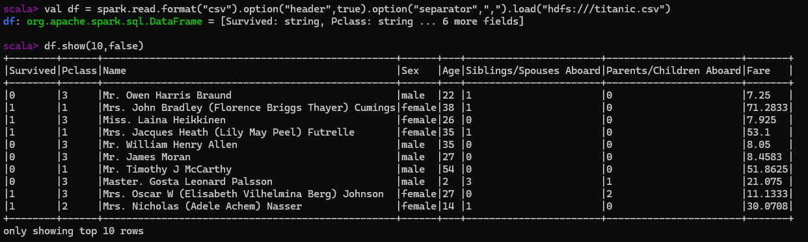 

3. To exit, enter:
```bash
:q
```

### 6.3 Use PySpark (Python)

1. Start the PySpark shell.
```bash
pyspark --master yarn --queue dev --name APPLICATION_NAME_PYSPARK
```
   > [!TIP]
   > Type the commands in the shell. Do not pipe them into `pyspark`. In that mode, the shell does not create the `spark` object. To run commands from a file, use `spark-submit` (see 6.4).
2. Load the data.
```python
df = spark.read.format("csv").option("header",True).option("separator",",").load("hdfs:///titanic.csv")
```
```python
df.show(10,False)
```

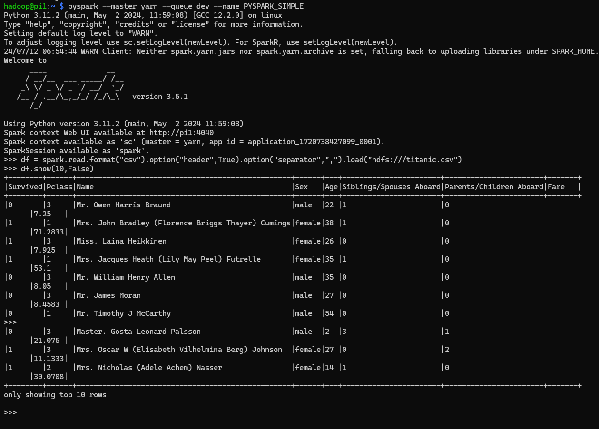 

3. To exit, enter:
```bash
exit()
```

### 6.4 Submit a file as a Spark job to YARN
This example uses Python. You can also run Scala and R scripts.

1. Create a Python file named `script.py`.
2. Edit the file to do a simple task.
```python
from pyspark.sql import SparkSession
from pyspark.sql.functions import col

# Create a SparkSession
spark = SparkSession.builder.appName("Testing PySpark Example").getOrCreate()

sample_data = [{"name": "John    D.", "age": 30},
  {"name": "Alice   G.", "age": 25},
  {"name": "Bob  T.", "age": 35},
  {"name": "Eve   A.", "age": 28}]

df = spark.createDataFrame(sample_data)

from pyspark.sql.functions import col, regexp_replace

# Remove additional spaces in name
def remove_extra_spaces(df, column_name):
    # Remove extra spaces from the specified column
    df_transformed = df.withColumn(column_name, regexp_replace(col(column_name), "\\s+", " "))

    return df_transformed

transformed_df = remove_extra_spaces(df, "name")

transformed_df.show()
```
3. Submit the Python script as a Spark job.
```bash
spark-submit --master yarn --queue prod ~/script.py
```

**Other examples (Scala and R):**
```bash
# For Scala and Java, use run-example:
./bin/run-example SparkPi

# For R examples, use spark-submit directly:
./bin/spark-submit examples/src/main/r/dataframe.R
```

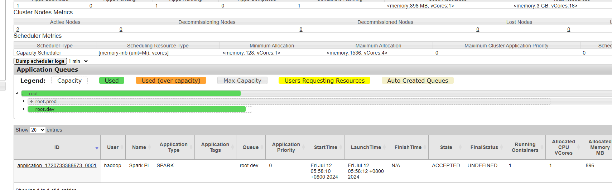 
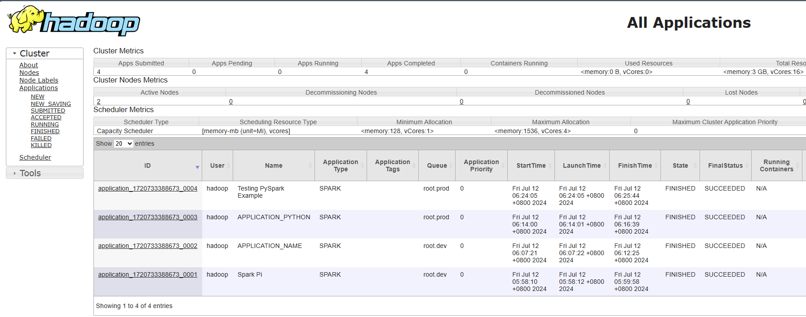 

The Spark cluster now works. Continue to explore.

---

## Part 7: Verify the cluster

> [!TIP]
> **Script:** `./scripts/verify.sh` runs all of these checks and shows PASS or FAIL for each check.

Do these checks in order. Stop at the first check that fails and correct the problem.

> [!IMPORTANT]
> Make sure that HDFS and YARN run. Do these checks on the master Pi `pi1` as the `hadoop` user, unless the text says to do otherwise.

1. **Java.** The command must show version 17 on `pi1`, `pi2` and `pi3`.
```bash
for pi in pi1 pi2 pi3; do ssh $pi 'java -version 2>&1 | head -1'; done
```
2. **Hadoop.** The command must show Hadoop 3.5.0.
```bash
hadoop version | head -1
```
3. **Daemons.** Run `jps` on each node. See Part 4 for the expected output.
4. **HDFS.** Write a file, read it back and delete it.
```bash
echo "hello hdfs" > /tmp/check.txt
hdfs dfs -put /tmp/check.txt /check.txt
hdfs dfs -cat /check.txt
hdfs dfs -rm /check.txt
```
5. **YARN.** Run the Hadoop example job. It must complete without errors.
```bash
yarn jar ~/hadoop-3.5.0/share/hadoop/mapreduce/hadoop-mapreduce-examples-3.5.0.jar pi -Dmapreduce.job.queuename=dev 2 10
```
6. **Spark.** Run the SparkPi example on YARN. The output must show a line that starts with `Pi is roughly 3.14`.
```bash
spark-submit --class org.apache.spark.examples.SparkPi --master yarn --queue dev /home/hadoop/spark-4.3.0/examples/jars/spark-examples_2.13-4.3.0.jar 10
```

If all checks pass, Java, Hadoop and Spark work together on your cluster.

---

## Quick reference

| Task | Command | Run on |
| --- | --- | --- |
| Start HDFS and YARN | `start-dfs.sh && start-yarn.sh` | `pi1` |
| Stop HDFS and YARN | `stop-dfs.sh && stop-yarn.sh` | `pi1` |
| Start the History Server | `start-history-server.sh` | `pi1` |
| Check the running processes | `jps` | each node |
| Check the whole cluster | `./scripts/verify.sh` | `pi1` |
| List the HDFS root | `hdfs dfs -ls /` | any node |
| Submit a job to the `dev` queue | `spark-shell --master yarn --queue dev` | `pi1` |
| Submit a job to the `prod` queue | `spark-submit --master yarn --queue prod ~/script.py` | `pi1` |

## Sources and more information

**Sources**

1. [How to Install and Set Up a 3-Node Hadoop Cluster](https://www.linode.com/docs/guides/how-to-install-and-set-up-hadoop-cluster/)
2. [Running Spark on Top of a Hadoop YARN Cluster](https://www.linode.com/docs/guides/install-configure-run-spark-on-top-of-hadoop-yarn-cluster/)
3. [Apache Hadoop Documentation](https://hadoop.apache.org/docs/stable/hadoop-project-dist/hadoop-common/ClusterSetup.html)
4. [Apache Spark Documentation](https://spark.apache.org/docs/latest/)
5. [Building a Raspberry Pi Hadoop / Spark Cluster](https://dev.to/awwsmm/building-a-raspberry-pi-hadoop-spark-cluster-8b2?fbclid=IwAR1jloBA6-6U3LhcxhkLT0Kq2Nx90YZjnCCIfT01SQSRs3mHHB87kt4AK4w)
6. [Getting Started with Hadoop & Apache Spark](https://youtube.com/playlist?list=PLJlKGwy-7Ac6ASmzZPjonzYsV4vPELf0x&si=IWXPkhC_r7mNN7IX)
7. [How to install hadoop cluster/multi node on ubuntu server 18.04](https://youtu.be/zGP0Uqm0SAo)
8. [Hadoop : Capacity Scheduler](https://hadoop.apache.org/docs/stable/hadoop-yarn/hadoop-yarn-site/CapacityScheduler.html#:~:text=etc%2Fhadoop%2Fcapacity%2Dscheduler,children%20of%20the%20root%20queue.)

**More information**

- [HDFS Shell Documentation](https://hadoop.apache.org/docs/current/hadoop-project-dist/hadoop-common/FileSystemShell.html)
- [PySpark Documentation](https://spark.apache.org/docs/latest/api/python/index.html)
- [Submitting Spark Applications](https://spark.apache.org/docs/latest/submitting-applications.html)

**Art:** the hero and data-flow animations were made with [Pixelbolt](https://github.com/skulitom/Pixelbolt). The recipes are in [`assets/src`](./assets/src).
