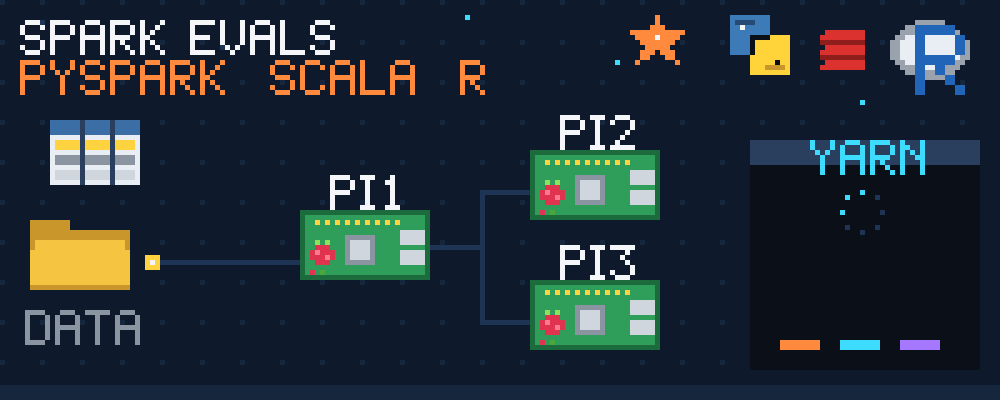
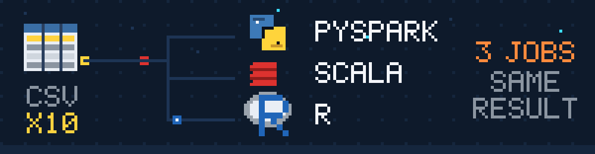
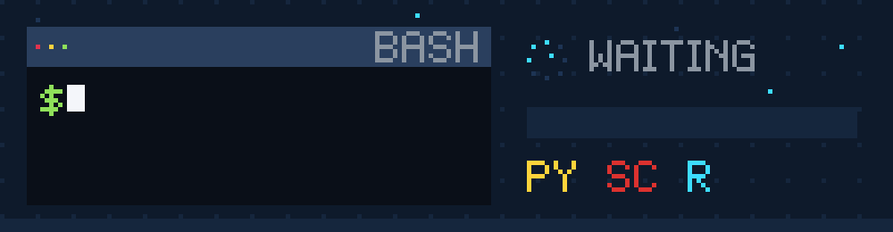
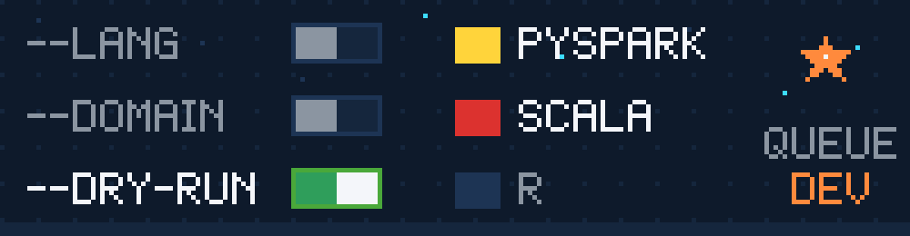
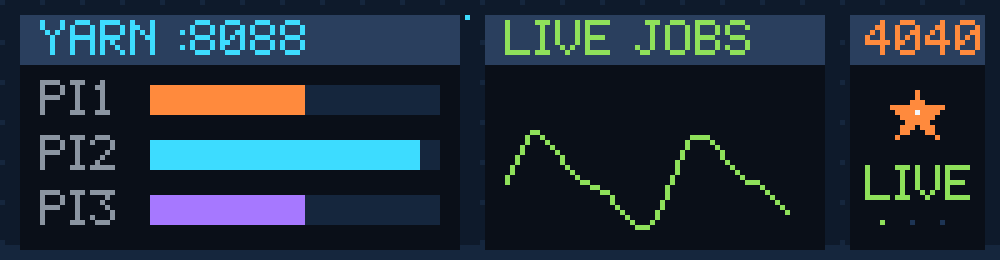
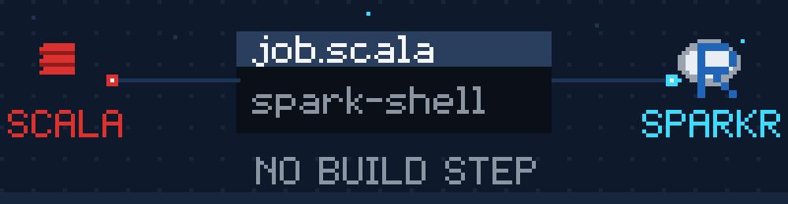
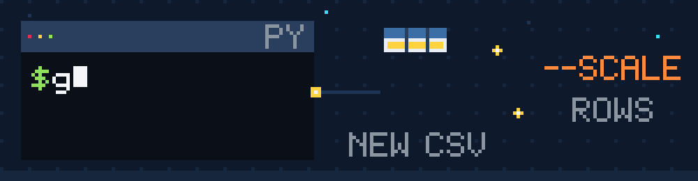
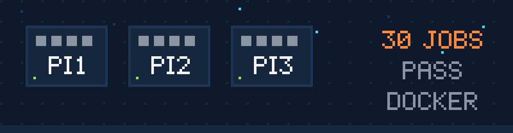

<p align="center">
  
</p>

# Spark evals

These evals prove that your cluster runs distributed Spark jobs. Each eval reads a CSV dataset from HDFS, cleans it, analyses it, and writes the results back to HDFS. Every eval prints the hosts that ran the work.

There are 10 datasets and 3 jobs for each dataset: PySpark, Spark Scala, and SparkR. The 3 jobs do the same analysis. The runner compares the numbers to prove that the 3 languages agree.

## Contents

1. [Folder layout](#folder-layout)
2. [Datasets and jobs](#datasets-and-jobs)
3. [Requirements](#requirements)
4. [Quick start](#quick-start)
5. [Runner options](#runner-options)
6. [Run one job by hand](#run-one-job-by-hand)
7. [Read the results](#read-the-results)
8. [Watch the jobs in the web UIs](#watch-the-jobs-in-the-web-uis)
9. [Notes on Scala and R](#notes-on-scala-and-r)
10. [Expected run time](#expected-run-time)
11. [Troubleshooting](#troubleshooting)
12. [Make new data](#make-new-data)
13. [What was tested](#what-was-tested)

## Folder layout

<p align="center">
  
</p>

```text
evals/
├── run-evals.sh            runner: upload, run, report
├── .env.example            settings (copy to .env to change them)
├── datasets/
│   ├── generate.py         makes all datasets (standard library only, seeded)
│   └── <domain>/*.csv      10 domains, 2 CSV files each
├── jobs/
│   ├── pyspark/<domain>.py
│   ├── scala/<domain>.scala
│   └── r/<domain>.R
└── results/                logs of each run (not in Git)
```

## Datasets and jobs

<p align="center">
  
</p>

Each dataset has one large table (50 500 rows, 2 to 4 MB) and one small lookup table. About 1% of the rows are duplicates. Other rows have null values, bad dates, impossible numbers, or messy text. The jobs clean these rows first.

Each job writes 3 result tables to `hdfs:///evals-out/<domain>/<language>/<result>/`: an aggregate, a top-10 list, and a window-function result. Each job also writes a `summary` file.

| Domain | Files and columns | What the jobs analyse |
|---|---|---|
| `finance` | `transactions.csv`: txn_id, account_id, txn_date, amount, currency, category, merchant, status<br>`accounts.csv`: account_id, segment, country, opened_date | Monthly spend by segment. Top 10 merchants. Transactions above 3 times the average of the same account (window average). |
| `logistics` | `shipments.csv`: shipment_id, carrier_id, origin, destination, ship_date, delivery_date, weight_kg, cost, status<br>`carriers.csv`: carrier_id, carrier_name, mode | Transit days, late percent, and cost per kg for each carrier. Top 10 routes. Change in shipments from the previous month (window `lag`). |
| `helpdesk` | `tickets.csv`: ticket_id, agent_id, category, priority, opened_date, closed_date, satisfaction<br>`agents.csv`: agent_id, team, level | Resolution days and satisfaction by team and priority. Top 10 agents. Best 3 agents in each team (window `row_number`). |
| `moderation` | `reports.csv`: report_id, moderator_id, report_date, content_type, reason, action, review_seconds<br>`moderators.csv`: moderator_id, region, shift | Review time and removal percent by reason. Top 10 moderators. Moderators 20% slower than their region (window average). |
| `restaurant` | `orders.csv`: order_id, restaurant_id, order_date, order_hour, item, qty, unit_price, discount_pct, payment<br>`restaurants.csv`: restaurant_id, city, cuisine | Revenue by city and cuisine. Top 10 items. Busiest hour for each cuisine (window `row_number`). |
| `inventory` | `stock_moves.csv`: move_id, sku, warehouse, move_date, move_type, qty_change<br>`products.csv`: sku, product_name, category, unit_cost, reorder_level | Net units and stock value by warehouse. Top 10 SKUs by units out. Moves that take stock below 0 (window running sum). SKUs below the reorder level. |
| `political` | `polls.csv`: poll_id, region_id, poll_date, party, support_pct, sample_size, pollster<br>`regions.csv`: region_id, region_name, population, area_type | Weighted support by party and area type. Top 10 regions for one party. Leading party in each region (window `row_number`). |
| `healthcare` | `visits.csv`: visit_id, patient_id, visit_date, department, diagnosis, duration_min, cost<br>`patients.csv`: patient_id, birth_year, sex, region | Cost and duration by department and age group. Top 10 diagnoses by cost. Visits within 30 days of the previous visit of the same patient (window `lag`). |
| `energy` | `readings.csv`: reading_id, meter_id, read_date, read_hour, kwh, voltage<br>`meters.csv`: meter_id, district, tariff | Total and average kWh by district and tariff. Top 10 meters. Readings above mean + 3 standard deviations of the same meter (window statistics). |
| `education` | `grades.csv`: grade_id, student_id, course_id, term, score, graded_date, attendance_pct<br>`courses.csv`: course_id, department, credits | Average score and pass rate by department and term. Top 10 students by credit-weighted score. Top 3 grades in each course (window `rank`). |

## Requirements

<p align="center">
  
</p>

- A running cluster from the main [README](../README.md): HDFS, YARN, and Spark 4.3.0 (`bin-hadoop3`) on the master node.
- Run all commands on the **master node** (`pi1`), as the `hadoop` user.
- Python 3.11 or later for the PySpark jobs. Spark 4.3 needs it.
- Scala jobs: nothing more. They run with `spark-shell` and need no compile step.
- R jobs (optional): R 4.0 or later on the master node.
  ```bash
  sudo apt install r-base-core
  ```
  The Spark 4.3.0 download contains SparkR in `$SPARK_HOME/R/lib/SparkR`. The Spark 4.3 documentation says SparkR is deprecated. It still works in these evals. If R is not installed, the runner skips the R jobs and prints why.
- About 30 MB free disk space in the repository and about 100 MB in HDFS (replication 1).

## Quick start

<p align="center">
  
</p>

1. Check the settings. The defaults match the main README (`pi1`, port 9000, queue `dev`).
   ```bash
   cp evals/.env.example evals/.env
   nano evals/.env
   ```
   The runner also reads `scripts/.env` when it exists.
2. List the jobs.
   ```bash
   ./evals/run-evals.sh --list
   ```
3. Do a dry run. The runner prints each command and runs nothing.
   ```bash
   ./evals/run-evals.sh --dry-run
   ```
4. Run one dataset in all 3 languages.
   ```bash
   ./evals/run-evals.sh --domain finance
   ```
5. Run everything (30 jobs).
   ```bash
   ./evals/run-evals.sh
   ```

## Runner options

<p align="center">
  
</p>

| Option | Meaning | Default |
|---|---|---|
| `--list` | Show the jobs and their dataset files. Run nothing. | |
| `--lang pyspark\|scala\|r\|all` | Languages to run. A comma list is allowed: `pyspark,r`. | `all` |
| `--domain <name>\|all` | Datasets to run. A comma list is allowed: `finance,energy`. | `all` |
| `--dry-run` | Print the commands. Run nothing. | |
| `--deploy-mode client\|cluster` | Where the Spark driver runs. Scala always uses `client`. | `client` |
| `--queue <name>` | YARN queue: `dev` (30%) or `prod` (70%). | `dev` |
| `--executors <N>` | Number of executors. | `2` |
| `--master <url>` | Use `local[2]` only for a quick test without YARN. | `yarn` |
| `--skip-upload` | Do not upload the datasets (they are in HDFS already). | |

Memory settings (`EXECUTOR_MEMORY`, `DRIVER_MEMORY`, `MEMORY_OVERHEAD`) are in `evals/.env`. Each container needs memory plus overhead: 512 MB + 256 MB = 768 MB. YARN gives 1536 MB to each node, so 2 containers fit on one node.

The runner sets `spark.sql.files.maxPartitionBytes` to 512 KiB. A 3 MB file then gives about 6 input tasks. Without this setting, Spark reads each small file as 1 task and nothing is distributed.

The exit code is `0` when no job failed, `1` when a job failed or the languages disagree, and `2` for a usage or setup error.

## Run one job by hand

<p align="center">
  
</p>

Upload the data first. Replace `finance` with your domain.

```bash
hdfs dfs -mkdir -p /evals/finance
hdfs dfs -put -f evals/datasets/finance/*.csv /evals/finance/
```

Use these shell variables in the commands below.

```bash
export IN=hdfs://pi1:9000/evals
export OUT=hdfs://pi1:9000/evals-out
export OPTS="--master yarn --queue dev --num-executors 2 --executor-memory 512m --driver-memory 512m \
  --conf spark.executor.memoryOverhead=256m --conf spark.sql.files.maxPartitionBytes=524288"
```

**PySpark**

```bash
spark-submit $OPTS --deploy-mode client evals/jobs/pyspark/finance.py $IN $OUT
```

**Scala** (no compile step; `spark-shell` reads the file and exits at the end)

```bash
spark-shell $OPTS --deploy-mode client \
  --conf spark.eval.input=$IN --conf spark.eval.output=$OUT \
  -i evals/jobs/scala/finance.scala < /dev/null
```

**R** (SparkR)

```bash
spark-submit $OPTS --deploy-mode client evals/jobs/r/finance.R $IN $OUT
```

For PySpark and R, you can use `--deploy-mode cluster`. The driver then runs on a worker node, and its output stays in the YARN logs. Read the `summary` file instead (see the next section).

## Read the results

<p align="center">
  
</p>

**On the console.** Each job prints 3 lines:

```text
EVAL_SUMMARY domain=finance lang=pyspark partitions=6 raw_rows=50500 clean_rows=45581 total_amount=2527158.86 flagged=2529
EVAL_HOSTS pi1,pi2,pi3
EVAL_STATUS OK
```

- `raw_rows` is the row count before cleaning. `clean_rows` is the count after cleaning and joining.
- `partitions` is the number of input tasks. A value above 1 means that Spark splits the file.
- `EVAL_HOSTS` lists the hosts that run a Spark JVM: the driver and the executors. In client mode with 2 executors, expect the master plus the workers that hold an executor. **More than one host is the proof of distributed work.**

**In the final table.** The runner prints PASS, FAIL, or SKIP for each job, with its time and clean row count. Then it prints a cross-language check. The line `finance: MATCH (3 languages)` means that PySpark, Scala, and R gave the same numbers. Last, the runner prints all hosts seen in the run.

**In log files.** Each run writes `evals/results/<run id>/<domain>-<language>.log` and `summary.tsv` (one row for each job, with the YARN application ID and hosts).

**In HDFS.** Result tables are CSV files with a header row.

```bash
hdfs dfs -ls /evals-out/finance/pyspark
hdfs dfs -cat /evals-out/finance/pyspark/top_merchants/part-*
hdfs dfs -cat /evals-out/finance/r/summary/part-*
```

To get a table on your laptop, use `hdfs dfs -get /evals-out/finance /tmp/finance-out`.

## Watch the jobs in the web UIs

<p align="center">
  
</p>

Open these pages in a browser on a computer in the same network. Replace `pi1` with your master host name or IP address.

| UI | Address | What you see |
|---|---|---|
| YARN ResourceManager | `http://pi1:8088` | Running and finished applications, queue (`root.dev` or `root.prod`), memory use, nodes at `/cluster/nodes`. |
| Spark live UI | click the **ApplicationMaster** link of a running application in the YARN UI | Jobs, stages, tasks, and the **Executors** tab (which host runs each executor). |
| Spark History Server | `http://pi1:18080` | The same Spark UI for finished applications. |
| HDFS NameNode | `http://pi1:9870` | Files in `/evals` and `/evals-out`, and the DataNodes. |

The runner prints the YARN address, the History Server address, and the application ID of each job. Each job takes only about 1 to 3 minutes, so open the YARN page before you start the batch. Use `--lang pyspark --domain finance` for a short run.

The History Server shows an application only after the application finishes and the event log is written (`spark.eventLog.enabled` is `true` in `config_files/spark-defaults.conf`).

## Notes on Scala and R

<p align="center">
  
</p>

**Scala.** A `spark-submit` run needs a jar, and compiling on a Raspberry Pi is slow. These evals use `spark-shell -i job.scala` instead. This route needs no compiler and no build tool. It has these limits:

- `spark-shell` runs in client mode only. The runner uses client mode for Scala, also when you pass `--deploy-mode cluster`, and prints a note.
- A `spark-shell` run has no arguments. The jobs read `spark.eval.input` and `spark.eval.output` from `--conf` instead.
- Each job ends with `sys.exit`. It exits with code 1 when the job fails.
- You must send the input from `/dev/null` (`< /dev/null`). Without it, the shell waits for input.

**R.** The jobs use SparkR DataFrame operations only. They do not use R functions on the workers (no `dapply`, `gapply`, or `spark.lapply`). Because of this:

- R is needed on the node where the driver runs. In client mode this is the master node.
- R is **not** needed on the workers. In `--deploy-mode cluster`, the driver runs on a worker, so R is then needed on **every** node.
- If you add your own R functions that run on the workers, install R on every node.

Two SparkR details that you may meet when you change the R jobs:

- `round(column, digits)` ignores `digits`. The jobs call the Spark SQL function through a helper named `rnd`.
- `3 * column` fails. Write `column * 3`. Joins need a Column expression, so the jobs use a helper named `ijoin`.
- Window `rowsBetween` with unbounded limits fails in SparkR. The inventory job uses the default window frame. This is the same result, because the sort key is unique.

If SparkR does not work on your build, the runner skips the R jobs with a clear message and the other jobs continue.

## Expected run time

<p align="center">
  
</p>

These numbers are an estimate. They come from tests on a 3-container YARN cluster on an Apple silicon Mac (about 50 to 80 seconds for each job). They are **not measured on Raspberry Pis**.

| Run | Mac, Docker (measured) | Raspberry Pi 4 (estimate) |
|---|---|---|
| 1 job | 35 to 80 s | 2 to 5 minutes |
| 1 dataset, 3 languages | 3 to 4 minutes | 6 to 15 minutes |
| All 30 jobs | about 31 minutes (53 to 70 s for each job) | 1.5 to 3 hours |

Most of the time is for starting the JVMs and the YARN containers, not for the data. R and Scala need more start time than PySpark. Larger data (see [Make new data](#make-new-data)) makes the Pis slower in proportion.

## Troubleshooting

<p align="center">
  
</p>

| Problem | Cause and fix |
|---|---|
| `spark-submit not found` | Set `SPARK_HOME` in `evals/.env`. The default is `/home/hadoop/spark-4.3.0`. |
| `The hdfs command is not found` | Set `HADOOP_HOME` in `evals/.env` or add `hadoop/bin` to `PATH`. |
| `Cannot create hdfs://pi1:9000/evals/...` | HDFS is not running. Run `./scripts/start-cluster.sh`, then `jps` on `pi1` and check for `NameNode`. |
| Job stays in `ACCEPTED` state | YARN has no free memory. Use a smaller `--executors`, or wait for other jobs. Check `http://pi1:8088/cluster/scheduler`. The `dev` queue has 30% of the memory. Use `--queue prod` for more. |
| `Required executor memory ... is above the max threshold (1536 MB)` | Memory plus overhead is above 1536 MB. Use `EXECUTOR_MEMORY=512m` and `MEMORY_OVERHEAD=256m`. |
| `Container killed ... running beyond physical memory limits` | Raise `MEMORY_OVERHEAD` to `384m` in `evals/.env`. Keep memory plus overhead at or below 1536 MB. |
| `Path does not exist: hdfs://.../evals/<domain>/...csv` | The data is not in HDFS. Run without `--skip-upload`. |
| `No CSV files in evals/datasets/<domain>` | Run `python3 evals/datasets/generate.py`. |
| `[SKIP] Rscript is not installed` | Install R: `sudo apt install r-base-core`. Or run with `--lang pyspark,scala`. |
| R job fails with `Rscript: command not found` in cluster mode | The driver runs on a worker. Install R on `pi2` and `pi3`, or use client mode. |
| PySpark job fails with `python3: not found` on a worker | Install Python 3.11 or later on every node. |
| Only 1 host in `EVAL_HOSTS` | Executors did not start on the workers. Check `yarn node -list` for 2 `RUNNING` nodes. Check that `--master` is `yarn`. |
| Scala job prints `EVAL_STATUS FAIL` | Read the log of the job in `evals/results/`. The first Spark error is above the stack trace. |
| Run is slow with no output | The first run uploads Spark libraries to HDFS for each application. To avoid this, set `spark.yarn.archive` as described in the Spark documentation (running on YARN). |
| Cross-language check says `differs` | Open `summary.tsv` and compare the two rows. A difference means a bug in one job. Please report it. |
| A job stopped with a timeout | Raise `JOB_TIMEOUT` in `evals/.env`. A stopped client can leave a YARN application running. Stop it with `yarn application -kill <application id>`. |

## Make new data

<p align="center">
  
</p>

The generator uses only the Python standard library. The output is the same for the same options.

```bash
python3 evals/datasets/generate.py                  # default: 50 000 rows in each large table
python3 evals/datasets/generate.py --scale 10       # 10 times more rows (about 30 MB for each table)
python3 evals/datasets/generate.py --rows 200000    # exact number of rows
python3 evals/datasets/generate.py --domain energy --seed 7 --out /tmp/data
```

Run `./evals/run-evals.sh` again after you change the data. The runner uploads the new files and replaces the old ones. Set `SPLIT_BYTES=67108864` (64 MB) for large data. Large data makes the Pis much slower, and 1536 MB nodes can fail on very large sets.

## What was tested

<p align="center">
  
</p>

The sample data and all 30 jobs were run with these setups:

- **Local mode**: all 30 jobs with `local[4]` in an Ubuntu 24.04 Docker container (OpenJDK 17, Python 3.12, R 4.3). The 3 languages gave the same summary and the same result tables for all 10 domains (30 result tables compared).
- **YARN on Docker**: a 3-container cluster (1 master with NameNode, ResourceManager, and History Server; 2 workers with DataNode and NodeManager). It used the Hadoop 3.5.0 and Spark 4.3.0 downloads, and the `config_files/` of this repository, which has the `dev` and `prod` queues and 1536 MB per node.

It was **not** tested on real Raspberry Pis. Check run time, memory, and the R and Scala jobs on your own cluster.

---

**Art:** the animations were made with [Pixelbolt](https://github.com/skulitom/Pixelbolt). The icons are small original pixel drawings, not the official logos. The generator script (`build-recipes.mjs`) and the render script (`render.sh`) are in [`assets/src`](./assets/src).
